# Design references: captured sites
Up: [[UI-Design-Ruleset]] · Related: [[WebUI Preferred Style Guide - Dataiku Dobre Ponder]] · [[ui-slop-patterns]] · [[qloop-ui-protocol]]

Captured 2026-11-17 at 1920×1080 with `ref-capture` (`AI-Agents/skills/ui-ux-qloop/scripts/ref-capture/`). Tokens are read from computed styles; library names are signatures found in scripts, evidence not proof. Cross-origin CSS cannot be read (count shown).

| Tier | Meaning | Skills in the stack |
|---|---|---|
| css | CSS transitions and keyframes only | transitions-dev |
| scripted | GSAP, Lenis, rAF loops or WAAPI drive the motion | gsap-animation, transitions-dev, react-bits |
| webgl | a real WebGL canvas or shaders | gsap-animation for the DOM layer; **no skill for WebGL / Three.js / shaders (gap)** |

| Site | Tier | Page transitions | Idle motion | Libraries |
|---|---|---|---|---|
| [icepanel-io](#icepanel-io) | scripted | - | yes | lottie |
| [likec4-dev](#likec4-dev) | scripted | - | yes | viewTransitions, framerMotion |
| [playground-likec4-dev](#playground-likec4-dev) | scripted | view-transitions-api | no | viewTransitions, framerMotion |
| [repowise-dev](#repowise-dev) | scripted | - | yes | viewTransitions |
| [structurizr-com](#structurizr-com) | css | - | no | - |

## icepanel-io
<https://icepanel.io>

**What I like:** _(yours, one or two lines)_

- **Scheme:** dark · bg #0c0d0d · text #ffffff, #adb3b3, #838a8d
- **Colours by area:** #161717, #0c0d0d, #ffffff, #4d265a, #146ef5, #eeb619
- **Fonts:** IBM Plex Sans, IBM Plex Mono · h1 60px/500 · body 14px
- **Radii:** 12px, 4px, 8px, 5px, 7px · **Shadows:** 0
- **Transitions (property, duration, easing):** opacity 0.2s ease-out · transform 0.3s cubic-bezier(0.22, 1, 0.36, 1) · opacity 0.15s cubic-bezier(0.4, 0, 0.2, 1) · transform 0.5s cubic-bezier(0.34, 1.56, 0.64, 1) · opacity 0.25s ease-out
- **Keyframes:** fa-beat, fa-bounce, fa-fade, fa-beat-fade, fa-flip, fa-shake, fa-spin, spin · scroll-driven CSS: yes · reduced-motion rule: yes · unreadable stylesheets: 0
- **Motion:** scripted · rAF 153/s idle · WAAPI calls 0 · canvases 0 (2d) · native scroll
- **Libraries seen:** lottie (animation.B-pEY364.js)
- **Rendered with:** chrome · ANGLE (AMD, AMD Radeon RX 6800 (0x000073BF) Direct3D11 vs_5_0 ps_5_0, D3D11)
- Frames: `01-hero` first screen, `01b` 0.9 s later (idle motion), `01c` after moving the cursor across the hero (reaction); the rest are scroll positions. One frame at a time: easing and feel need your eyes.

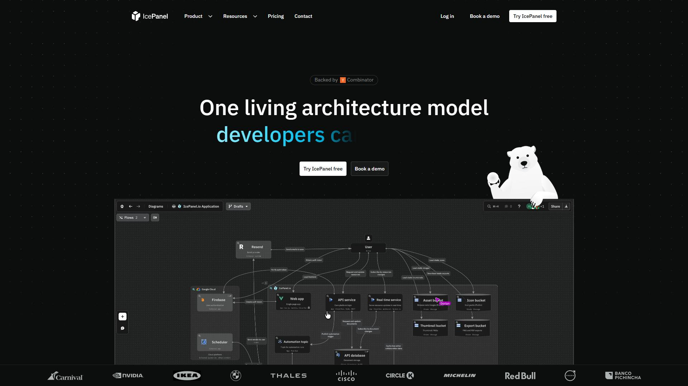
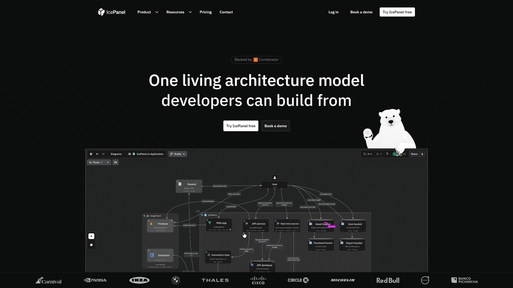
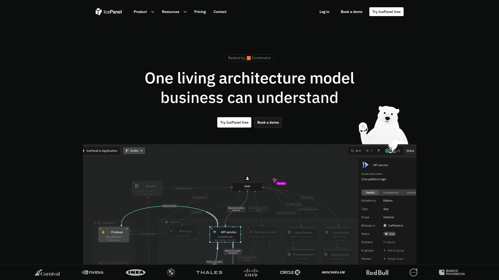
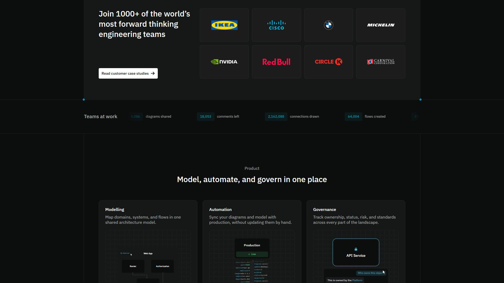
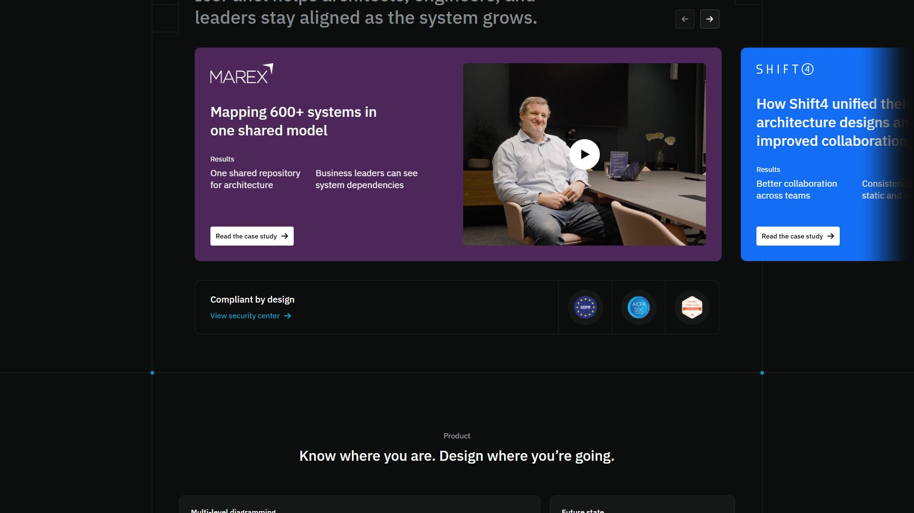
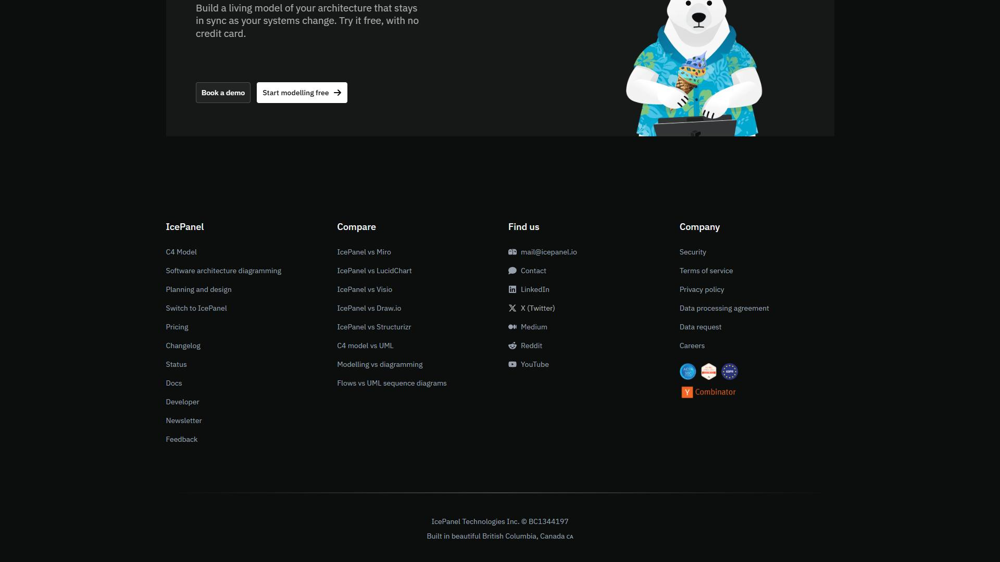

## likec4-dev
<https://likec4.dev>

**What I like:** _(yours, one or two lines)_

- **Scheme:** light · bg #ffffff · text #bf3441, #032f62, #005cc5
- **Colours by area:** #ffffff, #24292e, #06b6d4
- **Fonts:** Satoshi, IBM Plex Sans Variable · h1 72px/700 · body 18px
- **Radii:** 33554400px, 12px, 8px, 5px, 3px · **Shadows:** 2
- **Transitions (property, duration, easing):** all 0.2s cubic-bezier(0.4, 0, 0.2, 1) · opacity 0.6s cubic-bezier(0.16, 1, 0.3, 1) · transform 0.6s cubic-bezier(0.16, 1, 0.3, 1) · color 0.2s cubic-bezier(0.4, 0, 0.2, 1) · all 0.3s cubic-bezier(0.4, 0, 0.2, 1)
- **Keyframes:** pulse, demo-line-reveal, lp-fade-up, lp-slide-left, lp-slide-right · scroll-driven CSS: yes · reduced-motion rule: yes · unreadable stylesheets: 1
- **Motion:** scripted · rAF 0/s idle · WAAPI calls 1 · canvases 0 (no context) · native scroll
- **Libraries seen:** viewTransitions (client.D0dlRUIv.js); framerMotion (internal.BA7I0VoN.js)
- **Rendered with:** chrome · ANGLE (AMD, AMD Radeon RX 6800 (0x000073BF) Direct3D11 vs_5_0 ps_5_0, D3D11)
- Frames: `01-hero` first screen, `01b` 0.9 s later (idle motion), `01c` after moving the cursor across the hero (reaction); the rest are scroll positions. One frame at a time: easing and feel need your eyes.

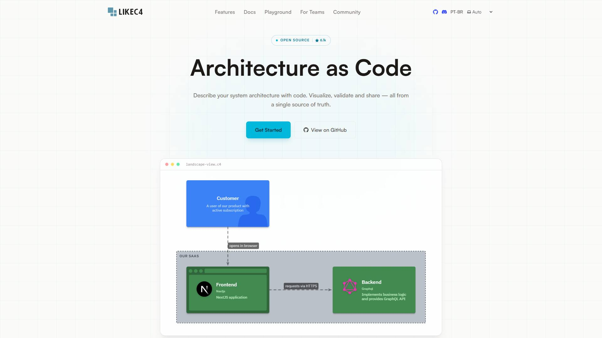
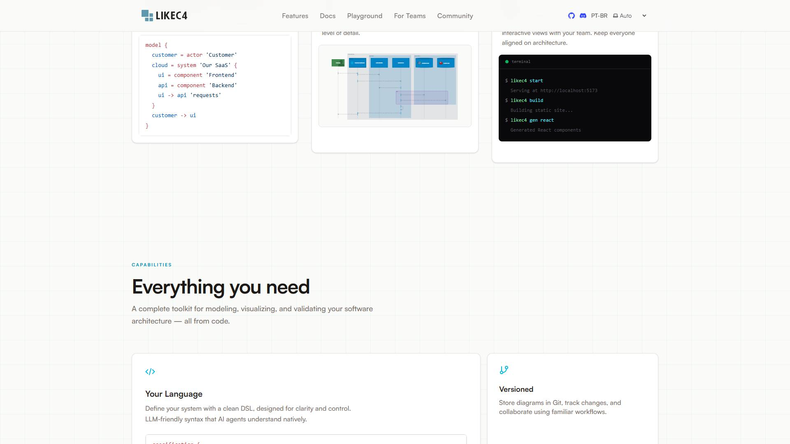
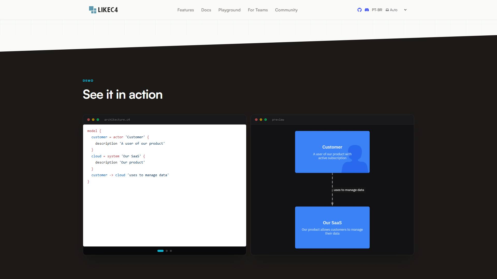
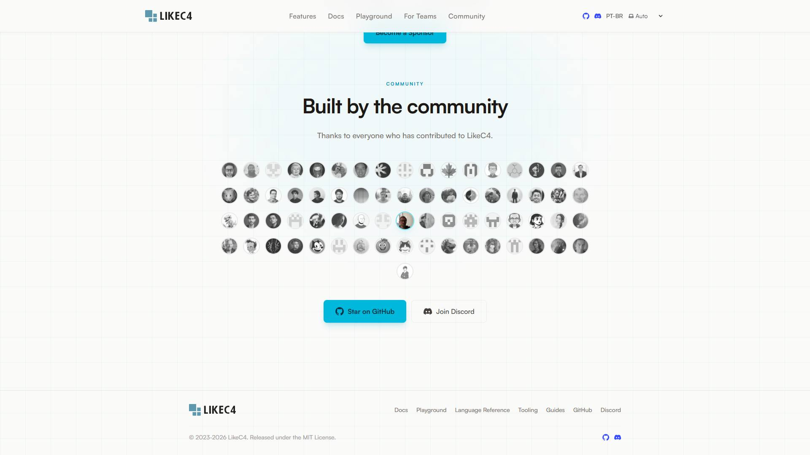

## playground-likec4-dev
<https://playground.likec4.dev>

**What I like:** _(yours, one or two lines)_

- **Scheme:** dark · bg #2e2e2e · text #ce9178, #6a9955, #858585
- **Colours by area:** #1e1e1e, #2e2e2e, #242424, #3b82f6, #424242, #1f1f1f
- **Fonts:** Fira Code, IBM Plex Sans Variable, codicon · h1 ?/? · body 12px
- **Radii:** 4px, 8px, 6px, 3px · **Shadows:** 3
- **Transitions (property, duration, easing):** transform 0.15s ease · opacity 0.1s ease · opacity 0.5s ease · transform 0.2s ease · background-color 0.15s cubic-bezier(0.2, 0.8, 0.2, 1)
- **Keyframes:** m_5d2b3b9d, m_aac34a1, m_f8e89c4b, m_885901b1, m_55dc625a, m_cdef532c, m_81a374bd, m_e0fb7a86 · scroll-driven CSS: yes · reduced-motion rule: yes · unreadable stylesheets: 0
- **Motion:** scripted · rAF 0/s idle · WAAPI calls 2 · canvases 0 (2d) · scroll did not move the page (virtual scroll or locked)
- **Libraries seen:** viewTransitions (index-pHyquBY-.js); framerMotion (index-pHyquBY-.js)
- **Rendered with:** chrome · ANGLE (AMD, AMD Radeon RX 6800 (0x000073BF) Direct3D11 vs_5_0 ps_5_0, D3D11)
- Frames: `01-hero` first screen, `01b` 0.9 s later (idle motion), `01c` after moving the cursor across the hero (reaction); the rest are scroll positions. One frame at a time: easing and feel need your eyes.

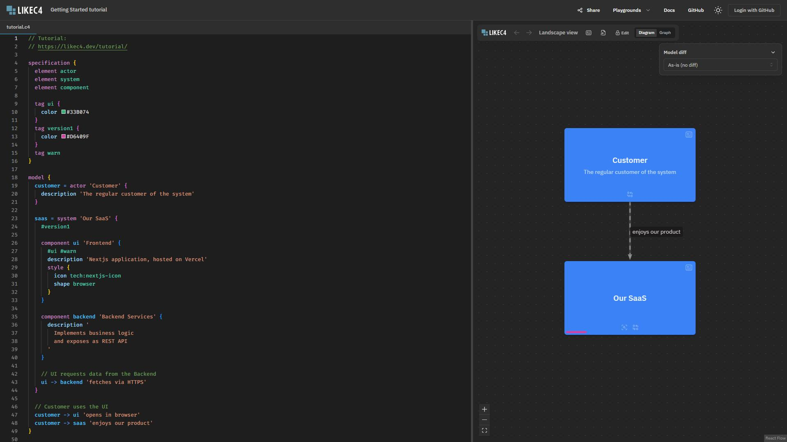

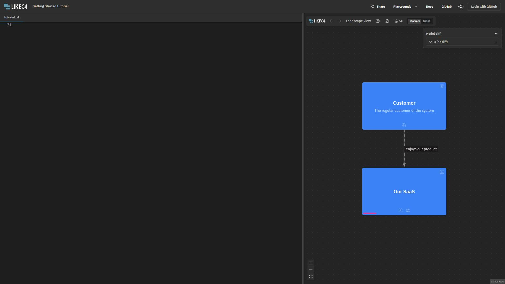

## repowise-dev
<https://repowise.dev>

**What I like:** _(yours, one or two lines)_

- **Scheme:** dark · bg #0f0c13 · text #bdb4c6, #f4f0f7, #8d8397
- **Colours by area:** #0f0c13, #15111a, #0b090e, #f4f0f7, #8d8397
- **Fonts:** Geist, Geist Fallback, Geist Mono, Geist Mono Fallback · h1 72px/600 · body 12px
- **Radii:** 8px, 6px, 4px, 14px, 33554400px · **Shadows:** 1
- **Transitions (property, duration, easing):** opacity 0.15s cubic-bezier(0.4, 0, 0.2, 1) · color 0.15s cubic-bezier(0.4, 0, 0.2, 1) · transform 0.15s cubic-bezier(0.4, 0, 0.2, 1) · opacity 0.5s ease-out · color 0.2s ease
- **Keyframes:** graph-path-pulse, graph-marching-ants, skeleton-sweep, owlOpen, owlMid, owlShut, fadeUp, fadeIn · scroll-driven CSS: no · reduced-motion rule: yes · unreadable stylesheets: 0
- **Motion:** scripted · rAF 120/s idle · WAAPI calls 0 · canvases 16 (2d) · native scroll
- **Libraries seen:** viewTransitions (4bd1b696-7281820e82fc5615.js)
- **Rendered with:** chrome · ANGLE (AMD, AMD Radeon RX 6800 (0x000073BF) Direct3D11 vs_5_0 ps_5_0, D3D11)
- Frames: `01-hero` first screen, `01b` 0.9 s later (idle motion), `01c` after moving the cursor across the hero (reaction); the rest are scroll positions. One frame at a time: easing and feel need your eyes.

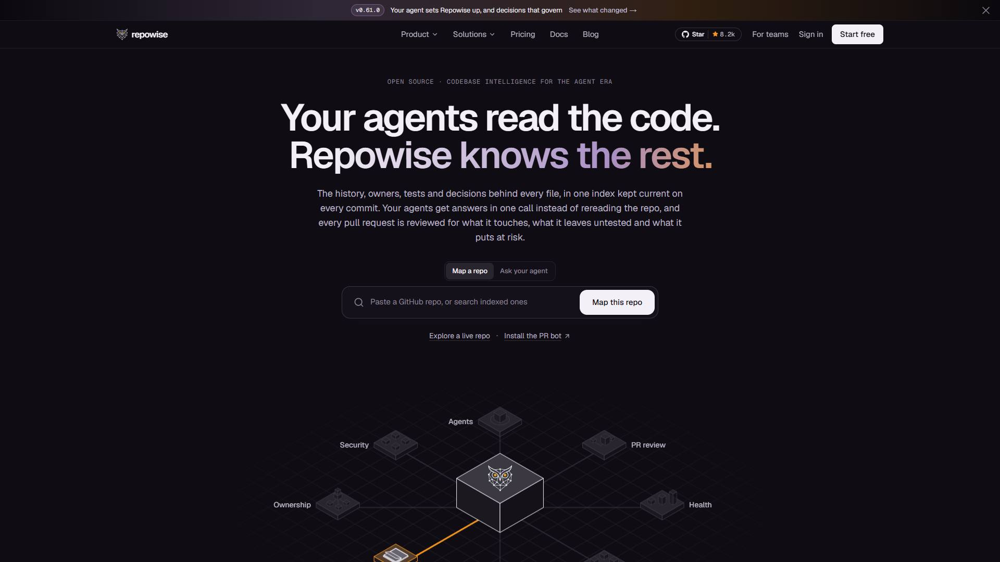
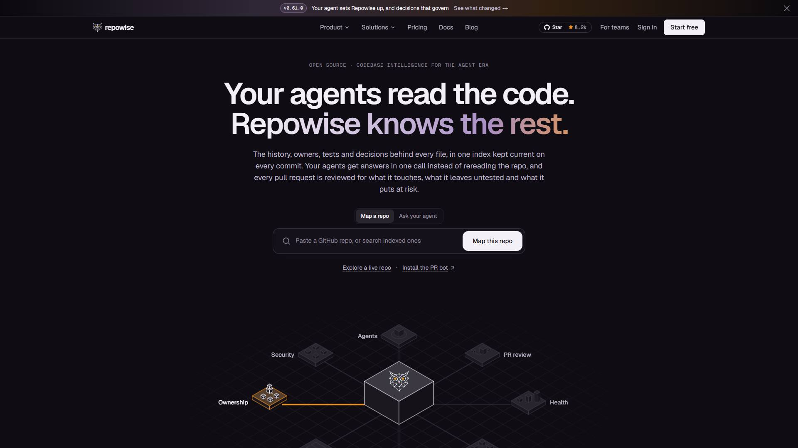
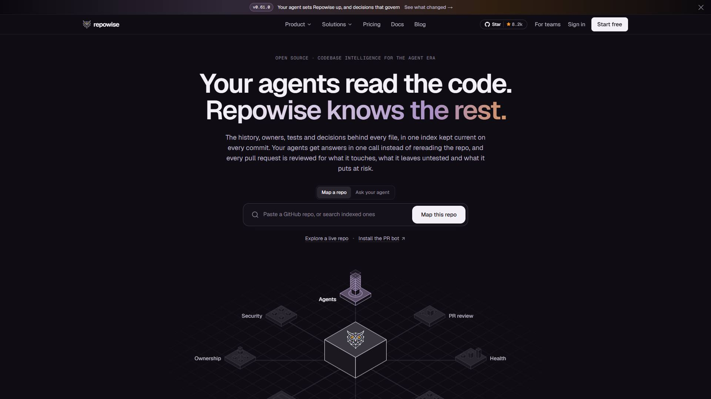
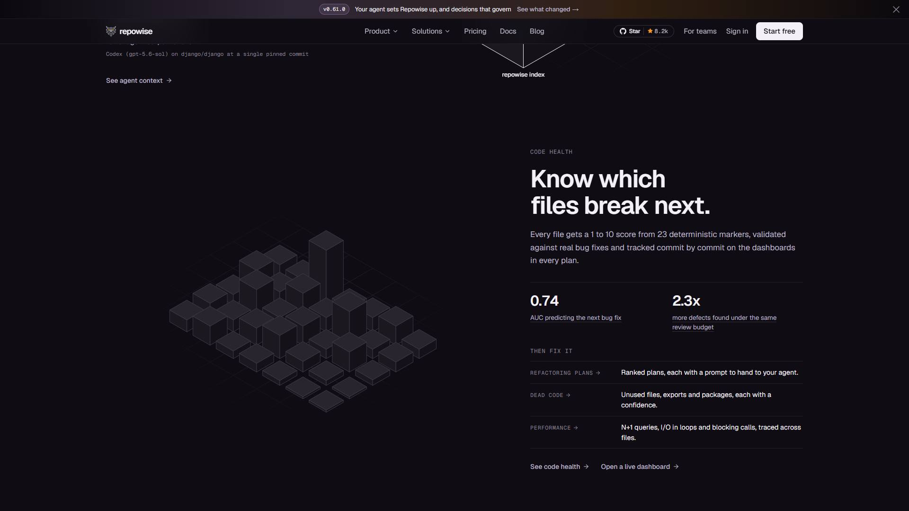
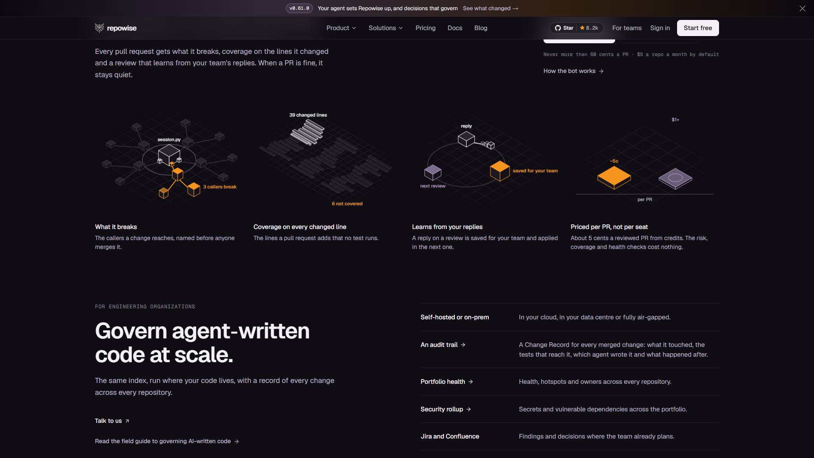
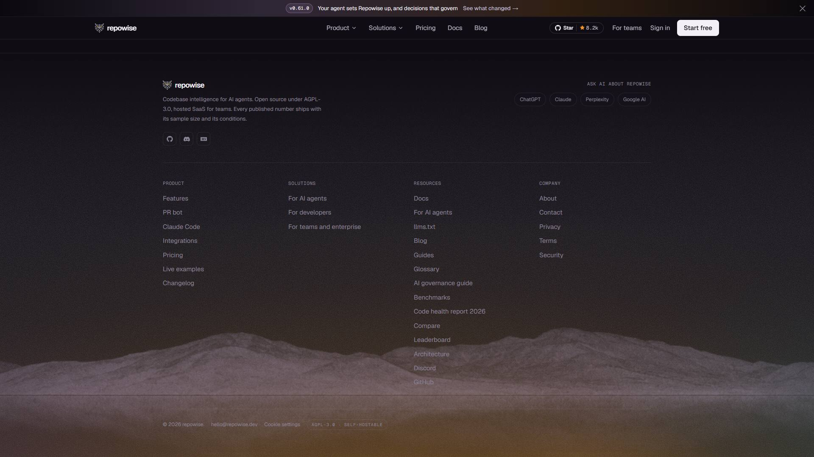

## structurizr-com
<https://structurizr.com>

**What I like:** _(yours, one or two lines)_

- **Scheme:** light · bg #ffffff · text #212529, #1168bd
- **Colours by area:** #ffffff
- **Fonts:** none reported · h1 ?/? · body 40px
- **Radii:** 6px · **Shadows:** 0
- **Transitions (property, duration, easing):** -
- **Keyframes:** progress-bar-stripes, spinner-border, spinner-grow, placeholder-glow, placeholder-wave · scroll-driven CSS: no · reduced-motion rule: yes · unreadable stylesheets: 0
- **Motion:** css · rAF 0/s idle · WAAPI calls 0 · canvases 0 (no context) · native scroll
- **Libraries seen:** none found
- **Rendered with:** chrome · ANGLE (AMD, AMD Radeon RX 6800 (0x000073BF) Direct3D11 vs_5_0 ps_5_0, D3D11)
- Frames: `01-hero` first screen, `01b` 0.9 s later (idle motion), `01c` after moving the cursor across the hero (reaction); the rest are scroll positions. One frame at a time: easing and feel need your eyes.

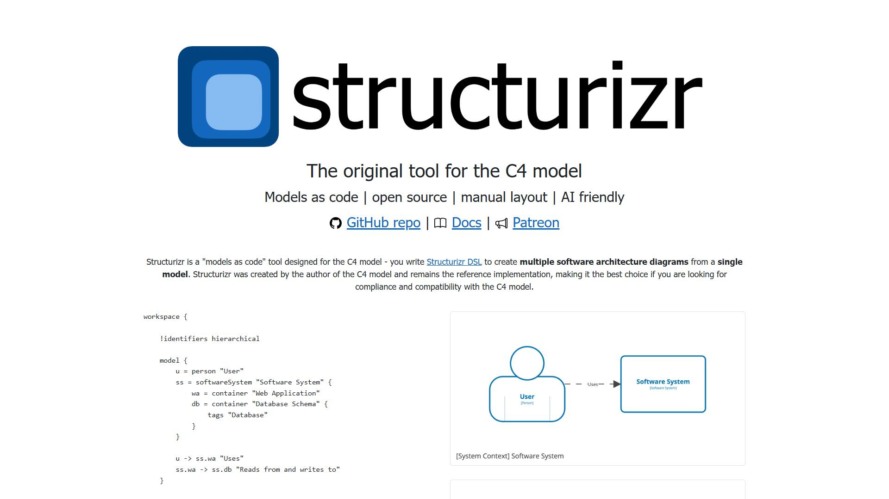

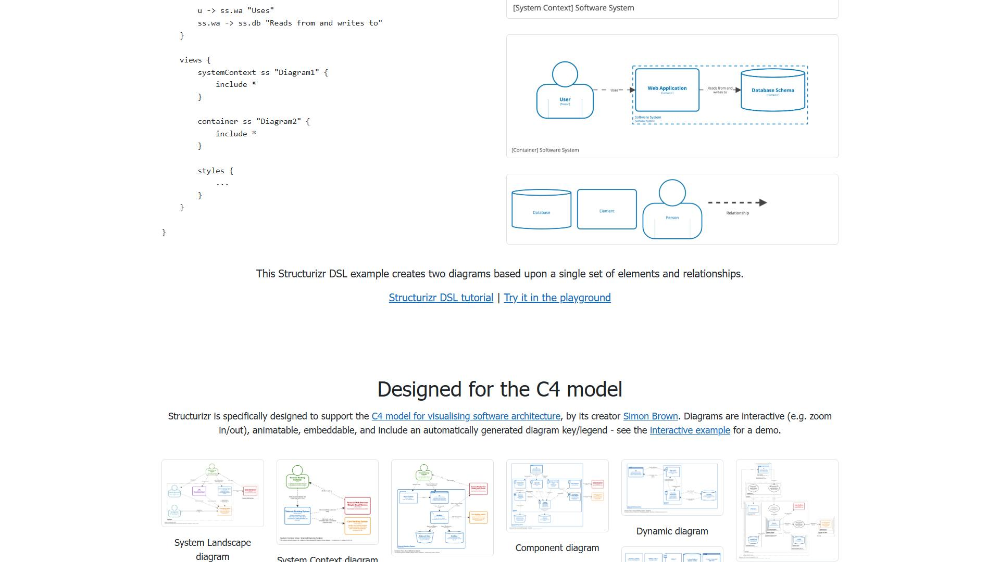
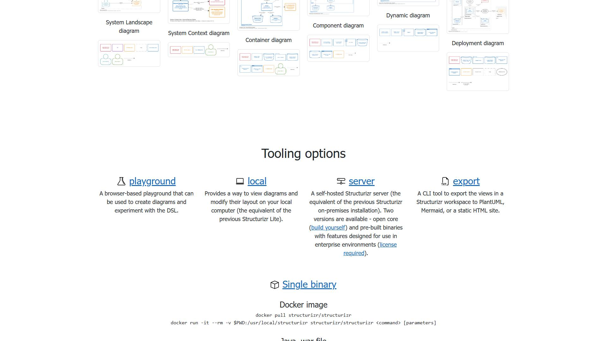
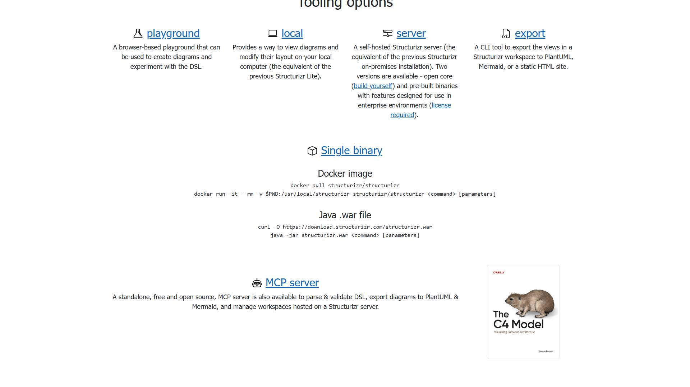

