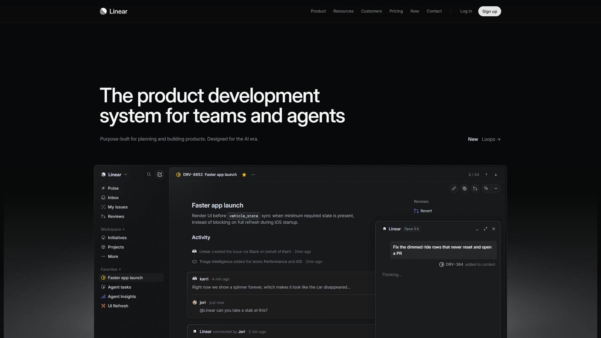
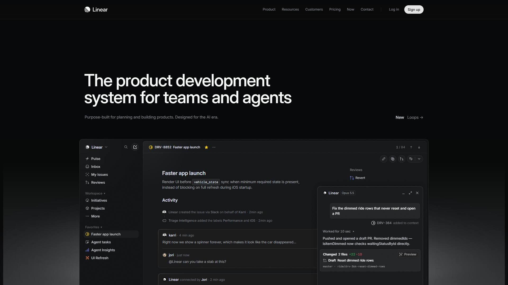
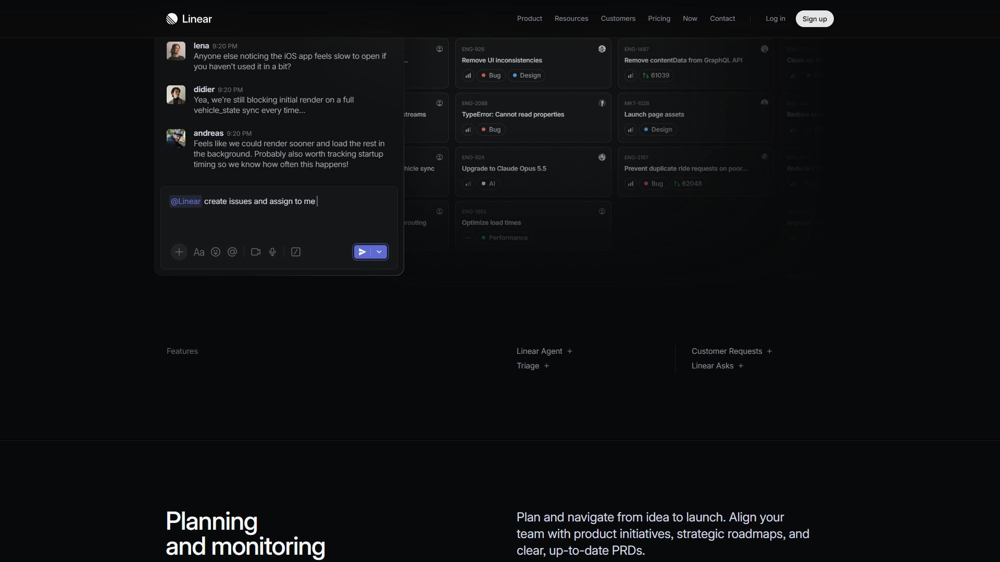
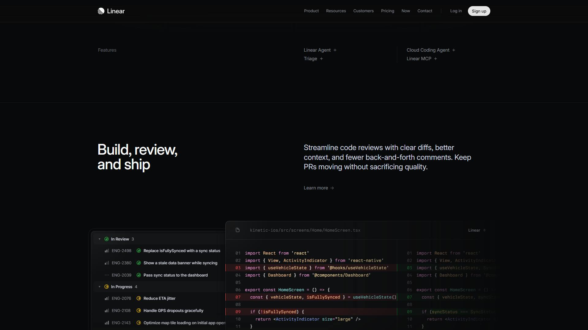
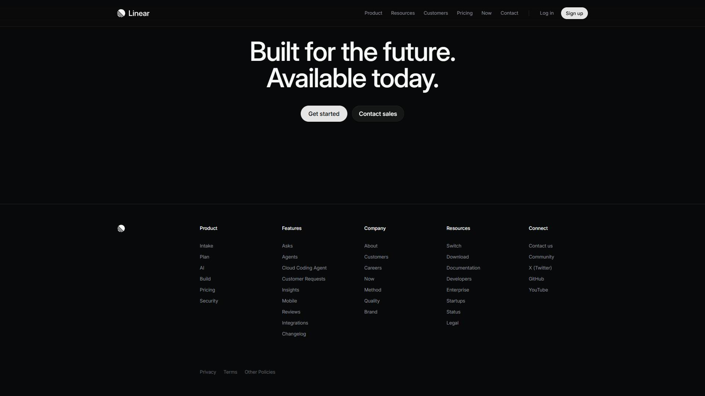
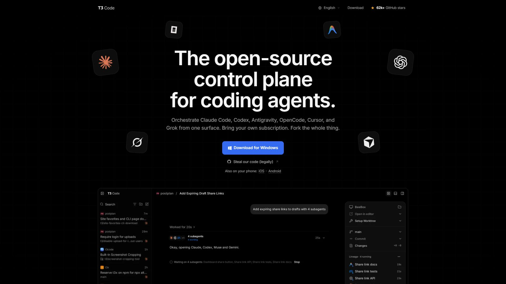
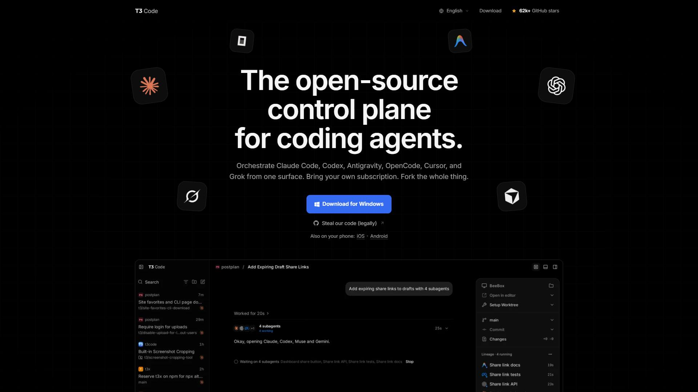
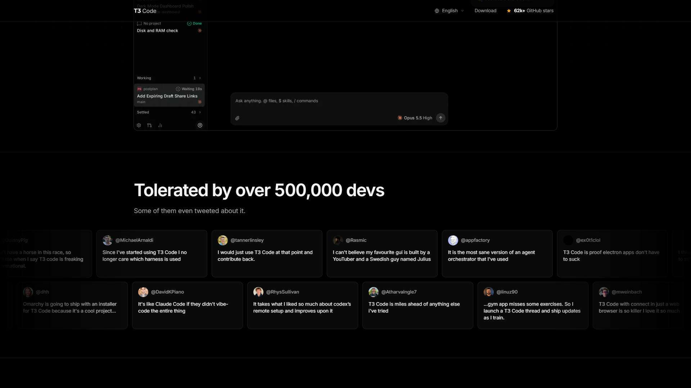
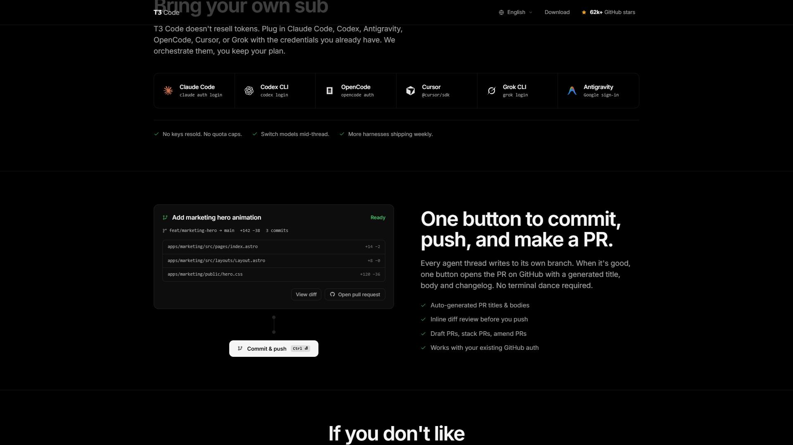
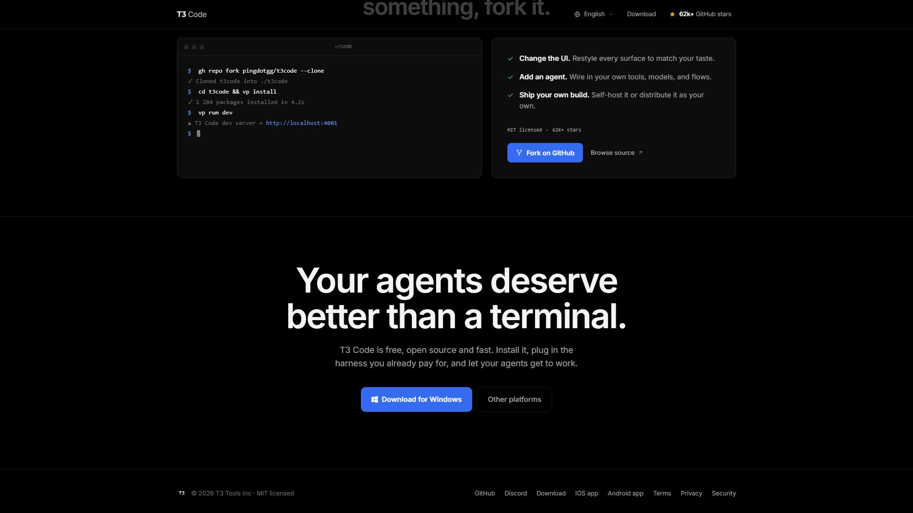

# Design references: captured sites
Up: [[UI-Design-Ruleset]] · Related: [[WebUI Preferred Style Guide - Dataiku Dobre Ponder]] · [[ui-slop-patterns]] · [[qloop-ui-protocol]]

Captured 2026-11-16 at 1920×1080 with `ref-capture` (`AI-Agents/skills/ui-ux-qloop/scripts/ref-capture/`). Tokens are read from computed styles; library names are signatures found in scripts, evidence not proof. Cross-origin CSS cannot be read (count shown).

| Tier | Meaning | Skills in the stack |
|---|---|---|
| css | CSS transitions and keyframes only | transitions-dev |
| scripted | GSAP, Lenis, rAF loops or WAAPI drive the motion | gsap-animation, transitions-dev, react-bits |
| webgl | a real WebGL canvas or shaders | gsap-animation for the DOM layer; **no skill for WebGL / Three.js / shaders (gap)** |

| Site | Tier | Page transitions | Idle motion | Libraries |
|---|---|---|---|---|
| [fabric-vc-portfolio](#fabric-vc-portfolio) | webgl | - | yes | lottie, webflow, three, shaders |
| [langchain-com](#langchain-com) | scripted | - | yes | gsap, splitText, ScrollTrigger, lottie, webflow, swiper |
| [linear-app](#linear-app) | scripted | view-transitions-api | yes | - |
| [mem0-ai](#mem0-ai) | webgl | - | no | shaders, framerMotion, viewTransitions |
| [mode-com](#mode-com) | scripted | - | yes | gsap, ScrollTrigger, lottie |
| [raycast-com](#raycast-com) | webgl | - | yes | viewTransitions, framerMotion, three, shaders, postprocessing |
| [t3-codes](#t3-codes) | css | - | no | - |
| [warp-dev](#warp-dev) | scripted | - | yes | framerMotion, viewTransitions |
| [zed-dev](#zed-dev) | webgl | - | yes | framerMotion, shaders, viewTransitions |

## fabric-vc-portfolio
<https://www.fabric.vc/portfolio>

**What I like:** _(yours, one or two lines)_

- **Scheme:** light · bg #f5f7fa · text #6b6b6b, #333333, #141414
- **Colours by area:** #ffffff, #f5f7fa, #f5f4f1, #333333, #f37021, #000000
- **Fonts:** webflow-icons, Ppmonumentextended, Ralegrotesk Regular, Ralegrotesk Medium, Inter Tight, Open Sans · h1 30px/600 · body 13px
- **Radii:** 50px, 10px, 12px, 8px, 6px · **Shadows:** 0
- **Transitions (property, duration, easing):** all 0.35s ease · color 0.4s ease
- **Keyframes:** spin · scroll-driven CSS: no · reduced-motion rule: no · unreadable stylesheets: 1
- **Motion:** webgl · rAF 241/s idle · WAAPI calls 0 · canvases 0 (2d, webgl2) · native scroll
- **Libraries seen:** lottie (fabric-vc.schunk.1d7c10fd23f22cc2.js, fabric-vc.schunk.f2efb3c5440a81cf.js); webflow (fabric-vc.schunk.1d7c10fd23f22cc2.js, chunk-GGDEANQW.js); three (fabric-ui-web-components.vanilla.js); shaders (fabric-ui-web-components.vanilla.js)
- **Rendered with:** chrome · ANGLE (AMD, AMD Radeon RX 6800 (0x000073BF) Direct3D11 vs_5_0 ps_5_0, D3D11)
- Frames: `01-hero` first screen, `01b` 0.9 s later (idle motion), `01c` after moving the cursor across the hero (reaction); the rest are scroll positions. One frame at a time: easing and feel need your eyes.

## langchain-com
<https://www.langchain.com>

**What I like:** _(yours, one or two lines)_

- **Scheme:** dark · bg #030710 · text #030710, #ffffff, #7fc8ff
- **Colours by area:** #f2faff, #05070b, #030710, #006ddd, #e5f4ff, #0b1018
- **Fonts:** Twklausanne, Aeonik, JetBrains Mono · h1 81px/200 · body 36px
- **Radii:** 7px, 18px, 999px, 32px, 16px · **Shadows:** 2
- **Transitions (property, duration, easing):** all 0.3s ease · opacity 0.3s ease · filter 0.3s ease · all 0.2s ease · opacity 0.25s cubic-bezier(0.6, 0, 0.15, 1)
- **Keyframes:** spin, hero-reveal-fallback, home-hero-wip-marquee-forward, home-hero-wip-marquee-reverse, glowIn, aadl-connector-draw · scroll-driven CSS: no · reduced-motion rule: yes · unreadable stylesheets: 1
- **Motion:** scripted · rAF 491/s idle · WAAPI calls 0 · canvases 1 (2d) · native scroll
- **Libraries seen:** gsap (SplitText.min.js, ScrollTrigger.min.js, gsap.min.js); splitText (SplitText.min.js, langchain-tonik.schunk.85ed95d69c749cb7.js, index.min.js); ScrollTrigger (ScrollTrigger.min.js, gsap.min.js, langchain-tonik.schunk.85ed95d69c749cb7.js); lottie (langchain-tonik.schunk.181a2070a530b302.js, langchain-tonik.schunk.85ed95d69c749cb7.js); webflow (langchain-tonik.schunk.85ed95d69c749cb7.js, scrolldisable.js, inline); swiper (swiper-bundle.min.js, inline)
- **Rendered with:** chrome · ANGLE (AMD, AMD Radeon RX 6800 (0x000073BF) Direct3D11 vs_5_0 ps_5_0, D3D11)
- Frames: `01-hero` first screen, `01b` 0.9 s later (idle motion), `01c` after moving the cursor across the hero (reaction); the rest are scroll positions. One frame at a time: easing and feel need your eyes.

## linear-app
<https://linear.app>

**What I like:** _(yours, one or two lines)_

- **Scheme:** dark · bg #08090a · text #d0d6e0, #8a8f98, #f7f8f8
- **Colours by area:** #08090a, #0f1011, #090a0b, #101112, #161718, #e4f222
- **Fonts:** Inter Variable, Berkeley Mono · h1 64px/510 · body 15px
- **Radii:** 9999px, 8px, 12px, 4px, 9px · **Shadows:** 3
- **Transitions (property, duration, easing):** color 0.1s cubic-bezier(0.25, 0.46, 0.45, 0.94) · color 0.1s ease · filter 0.16s cubic-bezier(0.25, 0.46, 0.45, 0.94) · transform 0.16s cubic-bezier(0.25, 0.46, 0.45, 0.94) · color 0.16s cubic-bezier(0.25, 0.46, 0.45, 0.94)
- **Keyframes:** _6QN9Vq_tooltipOpen, _6QN9Vq_tooltipClose, WinFxq_contextMenuIn, WinFxq_contextMenuOut, TZTsQG_mobileMenuIn, TZTsQG_mobileMenuOut, TZTsQG_slideFromRight, TZTsQG_slideFromLeft · scroll-driven CSS: yes · reduced-motion rule: yes · unreadable stylesheets: 0
- **Motion:** scripted · rAF 3/s idle · WAAPI calls 50 · canvases 0 (no context) · native scroll
- **Libraries seen:** none found
- **Rendered with:** chrome · ANGLE (AMD, AMD Radeon RX 6800 (0x000073BF) Direct3D11 vs_5_0 ps_5_0, D3D11)
- Frames: `01-hero` first screen, `01b` 0.9 s later (idle motion), `01c` after moving the cursor across the hero (reaction); the rest are scroll positions. One frame at a time: easing and feel need your eyes.

## mem0-ai
<https://mem0.ai>

**What I like:** _(yours, one or two lines)_

- **Scheme:** light · bg #ffffff · text #020202, #565553, #121212
- **Colours by area:** #ffffff, #121212, #cbb2ff, #fbfbfb, #171717, #27272a
- **Fonts:** Fustat, DM Mono, Fustat Medium, Fustat SemiBold, Fustat Variable Regular, Fustat Bold, Fustat Regular, Inter, Fustat Placeholder, Fustat Medium Placeholder, Fustat SemiBold Placeholder, Fustat Variable Regular Placeholder, Fustat Bold Placeholder, Fustat Regular Placeholder · h1 64px/600 · body 14px
- **Radii:** 4px, 6px, 8px, 12px, 10px · **Shadows:** 3
- **Transitions (property, duration, easing):** opacity 0.2s ease · all 0.3s ease · stroke-dashoffset 0.1s linear · opacity 0.1s ease
- **Keyframes:** __framer-editorbar-spinner-spin · scroll-driven CSS: yes · reduced-motion rule: no · unreadable stylesheets: 0
- **Motion:** webgl · rAF 241/s idle · WAAPI calls 24 · canvases 2 (webgl2, 2d) · native scroll
- **Libraries seen:** shaders (DitheringShader.BhNoHCHY.mjs, framer.Dw1G0qD3.mjs); framerMotion (ggXxcHyI2.CsqZozsX.mjs, OlcVhGB1h.DqT_bzhQ.mjs, Ry0ptF5SA.BSNKQpWO.mjs); viewTransitions (framer.Dw1G0qD3.mjs)
- **Rendered with:** chrome · ANGLE (AMD, AMD Radeon RX 6800 (0x000073BF) Direct3D11 vs_5_0 ps_5_0, D3D11)
- Frames: `01-hero` first screen, `01b` 0.9 s later (idle motion), `01c` after moving the cursor across the hero (reaction); the rest are scroll positions. One frame at a time: easing and feel need your eyes.

## mode-com
<https://mode.com>

**What I like:** _(yours, one or two lines)_

- **Scheme:** unknown · bg ? · text #043f2e, #eef2e3, #c8f169
- **Colours by area:** #043f2e, #2a6f2b, #78c51c, #c8f169, #eef2e3, #fcfcfc
- **Fonts:** Graphik, Grenette · h1 96px/400 · body 14px
- **Radii:** 16px, 4px, 8px · **Shadows:** 0
- **Transitions (property, duration, easing):** background 0.35s ease-in-out · color 0.25s ease-in-out · background-color 0.25s ease-in-out · all 0.4s ease · opacity 0.5s ease
- **Keyframes:** calendly-bouncedelay, scroll · scroll-driven CSS: yes · reduced-motion rule: no · unreadable stylesheets: 0
- **Motion:** scripted · rAF 245/s idle · WAAPI calls 7 · canvases 0 (2d) · native scroll
- **Libraries seen:** gsap (016b26c73a1ddf91f51f9a5dba966ef245ab4015-efb1e3c2ec530297cb08.js, b81efacd-40df6ec1c915a1d7ad3b.js); ScrollTrigger (016b26c73a1ddf91f51f9a5dba966ef245ab4015-efb1e3c2ec530297cb08.js, b81efacd-40df6ec1c915a1d7ad3b.js); lottie (94a7ad86-0f9f695aebf73ebdd4fd.js)
- **Rendered with:** chrome · ANGLE (AMD, AMD Radeon RX 6800 (0x000073BF) Direct3D11 vs_5_0 ps_5_0, D3D11)
- Frames: `01-hero` first screen, `01b` 0.9 s later (idle motion), `01c` after moving the cursor across the hero (reaction); the rest are scroll positions. One frame at a time: easing and feel need your eyes.

## raycast-com
<https://www.raycast.com>

**What I like:** _(yours, one or two lines)_

- **Scheme:** dark · bg #07080a · text #ffffff, #9c9c9d, #6a6b6c
- **Colours by area:** #07080a, #434345, #111214, #262626, #ffffff, #333333
- **Fonts:** Inter, Inter Fallback, GeistMono, jetBrainsMono · h1 64px/600 · body 18px
- **Radii:** 11px, 6px, 4px, 12px, 20px · **Shadows:** 3
- **Transitions (property, duration, easing):** opacity 0.4s cubic-bezier(0.23, 1, 0.32, 1) · box-shadow 0.2s cubic-bezier(0.23, 1, 0.32, 1) · transform 0.2s cubic-bezier(0.23, 1, 0.32, 1) · color 0.2s cubic-bezier(0.23, 1, 0.32, 1) · --key-bg-start-color 0.4s cubic-bezier(0.23, 1, 0.32, 1)
- **Keyframes:** IS8qgq_nightRider, j3Kqfa_iconSuccess, FPj0oG_fadeInUp, _80EXsG_loadingSweep, _80EXsG_blink, O9JzEq_slideUpAndFade, O9JzEq_slideRightAndFade, O9JzEq_slideDownAndFade · scroll-driven CSS: yes · reduced-motion rule: yes · unreadable stylesheets: 0
- **Motion:** webgl · rAF 120/s idle · WAAPI calls 0 · canvases 1 (webgl2) · native scroll
- **Libraries seen:** viewTransitions (3932hcp5qo4g3.js, 0o-9t_s7w6-t8.js); framerMotion (327rhipracuv3.js); three (0o-9t_s7w6-t8.js); shaders (0o-9t_s7w6-t8.js, 0g9me6ox1p3e7.js); postprocessing (0g9me6ox1p3e7.js)
- **Rendered with:** chrome · ANGLE (AMD, AMD Radeon RX 6800 (0x000073BF) Direct3D11 vs_5_0 ps_5_0, D3D11)
- Frames: `01-hero` first screen, `01b` 0.9 s later (idle motion), `01c` after moving the cursor across the hero (reaction); the rest are scroll positions. One frame at a time: easing and feel need your eyes.

## t3-codes
<https://t3.codes>

**What I like:** _(yours, one or two lines)_

- **Scheme:** dark · bg #000000 · text #f5f5f5, #a3a3a3, #737373
- **Colours by area:** #0a0a0a, #000000, #0d0d0d, #f5f5f5, #262626
- **Fonts:** Inter Variable · h1 76px/600 · body 19px
- **Radii:** 10px, 50%, 6px, 25%, 8px · **Shadows:** 2
- **Transitions (property, duration, easing):** background 0.18s ease · border-color 0.18s ease · color 0.18s ease · color 0.2s ease · transform 0.18s ease
- **Keyframes:** fade-in, rise, mark-in, endorsementMarquee, blink · scroll-driven CSS: yes · reduced-motion rule: yes · unreadable stylesheets: 0
- **Motion:** css · rAF 0/s idle · WAAPI calls 0 · canvases 0 (no context) · native scroll
- **Libraries seen:** none found
- **Rendered with:** chrome · ANGLE (AMD, AMD Radeon RX 6800 (0x000073BF) Direct3D11 vs_5_0 ps_5_0, D3D11)
- Frames: `01-hero` first screen, `01b` 0.9 s later (idle motion), `01c` after moving the cursor across the hero (reaction); the rest are scroll positions. One frame at a time: easing and feel need your eyes.

## warp-dev
<https://www.warp.dev>

**What I like:** _(yours, one or two lines)_

- **Scheme:** unknown · bg ? · text #1a1522, #2a1eff, #ffffff
- **Colours by area:** #ffffff, #fbf9fe, #f6f5fb, #dedede, #e9e1f5, #2a1eff
- **Fonts:** matter Fallback, azeretSemiMono, azeretSemiMono Fallback, Matter · h1 54px/400 · body 16px
- **Radii:** 999px, 4px, 6px, 33554400px · **Shadows:** 0
- **Transitions (property, duration, easing):** color 0.3s ease · opacity 0.15s ease · filter 0.15s ease · border-color 0.15s ease · color 0.12s ease
- **Keyframes:** reveal, demo-stage-in, fill-progress, scroll-left, scroll-right, loading-spinner-in, warp-lite-story-reveal, warp-lite-row-exit · scroll-driven CSS: yes · reduced-motion rule: yes · unreadable stylesheets: 0
- **Motion:** scripted · rAF 0/s idle · WAAPI calls 0 · canvases 1 (2d) · native scroll
- **Libraries seen:** framerMotion (0jx-eun2vqw72.js); viewTransitions (3aw5dhxsjeetj.js)
- **Rendered with:** chrome · ANGLE (AMD, AMD Radeon RX 6800 (0x000073BF) Direct3D11 vs_5_0 ps_5_0, D3D11)
- Frames: `01-hero` first screen, `01b` 0.9 s later (idle motion), `01c` after moving the cursor across the hero (reaction); the rest are scroll positions. One frame at a time: easing and feel need your eyes.

## zed-dev
<https://zed.dev>

**What I like:** _(yours, one or two lines)_

- **Scheme:** unknown · bg ? · text #242529, #58585a, #3882b7
- **Colours by area:** #eee7e7, #dcdcdd, #fafafa, #ebebec, #cde4d6, #e6d1d5
- **Fonts:** writer, plexSerif · h1 25.6px/390 · body 14px
- **Radii:** 4px, 2px, 3px, 8px, 6px · **Shadows:** 3
- **Transitions (property, duration, easing):** transform 0.15s cubic-bezier(0.4, 0, 0.2, 1) · opacity 0.2s cubic-bezier(0.4, 0, 0.2, 1) · transform 0.4s cubic-bezier(0.32, 0.72, 0, 1) · all 0.15s cubic-bezier(0.4, 0, 0.2, 1)
- **Keyframes:** fade-on-scroll, hero-rise, hero-drop, fade-to-current, marquee-scroll, progressIncrease, loading, shimmer · scroll-driven CSS: no · reduced-motion rule: yes · unreadable stylesheets: 0
- **Motion:** webgl · rAF 362/s idle · WAAPI calls 0 · canvases 3 (webgl2) · scroll did not move the page (virtual scroll or locked)
- **Libraries seen:** framerMotion (3gj16syrew9r-.js, 3a9vyga6a6cvi.js); shaders (3a11v5-qcc-3j.js, 0fbxn_2rj21c6.js); viewTransitions (14dekpless3fj.js)
- **Rendered with:** chrome · ANGLE (AMD, AMD Radeon RX 6800 (0x000073BF) Direct3D11 vs_5_0 ps_5_0, D3D11)
- Frames: `01-hero` first screen, `01b` 0.9 s later (idle motion), `01c` after moving the cursor across the hero (reaction); the rest are scroll positions. One frame at a time: easing and feel need your eyes.

