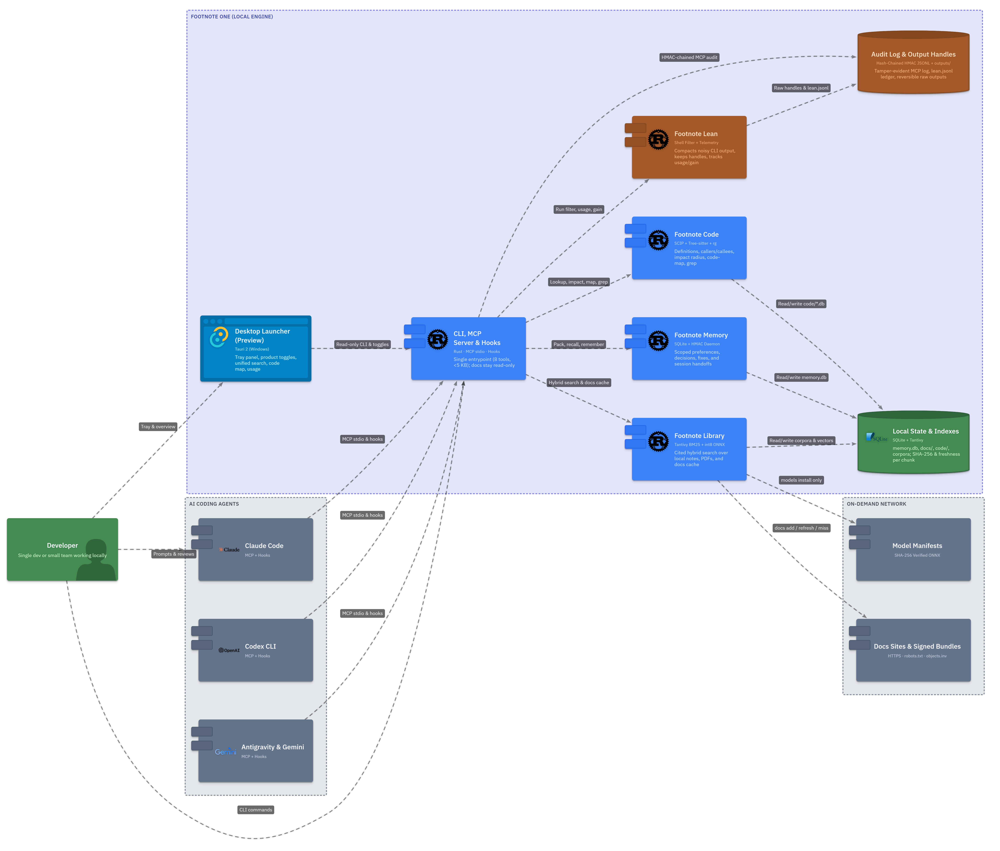

<div align="center">

# Footnote<sup>1</sup>

**Local memory, docs search, code graph, and token-lean tooling for AI coding agents.**<br>
**One Apache-2.0 Rust binary. Every answer carries a footnote.**

Works with Claude Code, Codex CLI, Gemini CLI, Antigravity (including T3 Code), Grok, DeepSeek Harness, or any MCP stdio host.

[](LICENSE)
[](Cargo.toml)
[](#connect-your-agent)
[](https://github.com/bobcat88/footnote/releases)

[Install](#install) · [What it does](#what-it-does) · [Architecture](#architecture) · [Philosophy](#philosophy) · [Measured proof](#measured-proof) · [Status & limits](#status--limits) · [Setup Guide (`HOW-TO.md`)](HOW-TO.md)

</div>

---

```text
agent ▸ footnote_recall("why does the WAL checkpoint stall under write load")

¹  Checkpoint latency is amortized through batching; a long reader holds the
   WAL open and the checkpoint cannot finish.
   notes/sqlite.md · §WAL · line 42 · rev 4 · current · sha256 3fa9c1d07b2e

²  After a reader-heavy night, run a passive checkpoint before the batch job starts.
   ops/runbook.md · page 3 · rev 1 · stale (file changed since indexing) · sha256 9b0e77a41c58
```

<sup>1</sup> *Illustrative output showing the real fields returned by the tools: `path`, `heading`, `page`, `line`, `revision`, `sha256`, `freshness`.*

---

## What it does

Instead of bolting four separate MCP servers, Python runtimes, and cloud accounts onto your coding agent, **Footnote** packs four local, independently toggleable (`footnote config`) modules into one fast Rust binary with a compact **8-tool, <5 KB** MCP schema:

| Module | What you get |
|---|---|
| **Library** | Hybrid search (Tantivy BM25 + local int8 ONNX embeddings) over your Markdown, text, PDFs, and a machine-wide crawled docs cache (`footnote docs add`). Every hit is bound to file, line, SHA-256, and freshness (`current` / `stale`). |
| **Memory** | Persistent per-machine agent memory (preferences, decisions, fixes, session handoffs) wired via lifecycle hooks across Claude Code, Codex, Gemini CLI, Antigravity, Grok, and DeepSeek Harness. No second LLM reads your chat — your agent saves its own memories locally. |
| **Code** | Compiler-grade (SCIP via `rust-analyzer`, `scip-typescript`, `scip-python`) with tree-sitter fallback: definitions, callers/callees, impact radius, architecture map (`code-map`), file outlines, project stack/readiness (`stack`, `frame`), and native ripgrep (`footnote grep`) with enclosing-symbol spans. |
| **Lean** | Preservation-first shell output compaction (`footnote run`, `footnote hook lean`) with reversible raw output handles (`footnote output <id>`), Turn-1 prompt/MCP bloat audit (`footnote audit-prefix`), and local token/cost/savings accounting (`footnote usage`, `footnote gain`). |

---

## Architecture



*Source: [docs/architecture/footnote.c4](docs/architecture/footnote.c4) (LikeC4) · Editable export: [docs/architecture/footnote-overview.drawio](docs/architecture/footnote-overview.drawio)*

---

## Philosophy

1. **Verifiable over magical.** An agent that "remembers" is only trustworthy if it tells you *where* a fact came from and whether the source file changed since indexing.
2. **Local-first, zero cloud, zero telemetry.** SQLite + Tantivy + local CPU embeddings inside the binary. Your documents are strictly **read-only** for agents; every MCP call is appended to a local HMAC-chained audit log.
3. **Token sobriety.** Fixed prompt overhead is re-read on every turn. Footnote keeps its MCP `tools/list` under 5 KB, compacts noisy test/build/git output without hiding errors or edit anchors, and triggers session handoffs before huge contexts burn your budget.
4. **Measured before shipped.** Changes to retrieval, chunking, or compaction only land if they beat a decision rule written down *before* running the benchmark. Failed experiments stay in the log.

---

## Install

### Option A: Prebuilt binary (Windows x64 & Linux x64)

Download the latest archive or run the installer from [GitHub Releases](https://github.com/bobcat88/footnote/releases):

```powershell
# Windows (PowerShell)
irm https://github.com/bobcat88/footnote/releases/latest/download/footnote-installer.ps1 | iex
```

```bash
# Linux (x86_64)
curl --proto '=https' --tlsv1.2 -LsSf https://github.com/bobcat88/footnote/releases/latest/download/footnote-installer.sh | sh
```

### Option B: Build from source

Requires **Rust 1.100+** (Python 3.11+ is optional and only used for PDF extraction/OCR).

```bash
git clone https://github.com/bobcat88/footnote && cd footnote
cargo build --locked --release
export PATH="$PWD/target/release:$PATH"
```

### Quick start (2 minutes)

```bash
# 1. One-time SHA-256 verified download of the two local embedding models (~200 MB, no Python needed)
footnote models install bekko-a8m gte-small
footnote models use bekko-a8m gte-small

# 2. Wire Memory + Lean hooks and MCP config across every detected agent (preview with --dry-run)
footnote install

# 3. Optional: build a code graph for the current repo, or cache a docs site once for all projects
footnote code-index .
footnote docs add https://flask.palletsprojects.com/en/stable/ --site flask
```

- **Local notes corpus:** `footnote --db ~/.footnote/knowledge.db index --root ~/notes --allow ~/notes` followed by `rebuild-embeddings` and `footnote --db ~/.footnote/knowledge.db install`.
- **Update & rollback:** `footnote update --from <new-binary>` atomically swaps binaries even while agents run; `footnote rollback` restores the previous one.
- **Uninstall:** `footnote uninstall --memory --lean` cleanly removes hooks and MCP entries while keeping your databases and backups.
- **Full OS & harness walkthrough:** see **[HOW-TO.md](HOW-TO.md)**.
- **Docker (Windows App Control, shared hub):** a hardened image (`Dockerfile`), a long-lived daemon for several agents (`compose.yaml`), and one command that registers Claude Code, Codex, Gemini CLI and Antigravity with it (`scripts/docker-agents.ps1` / `.sh`). See [HOW-TO.md → Docker](HOW-TO.md#docker-when-windows-blocks-local-builds).

### Connect your agent

`footnote install` auto-detects and configures Claude Code, Codex CLI, Gemini CLI, Antigravity (`~/.gemini/config` and T3 Code isolated providers), Grok, and DeepSeek Harness — never overwriting existing entries and backing up every file it touches.

For any other MCP host (Cursor, Windsurf, Zed, VS Code, Cline, Hermes):

```json
{
  "mcpServers": {
    "footnote": {
      "command": "/absolute/path/to/footnote",
      "args": ["--db", "/absolute/path/to/knowledge.db", "mcp"]
    }
  }
}
```

---

## Measured proof

All numbers come from stored receipts in [`bench/receipts`](bench/receipts) on the shipped binary, through a resident MCP session, with both local embedding models (`bekko-a8m` multilingual + `gte-small` English, int8 quantized):

### Retrieval quality (nDCG@10)

| Benchmark | Language | BM25 baseline | Footnote |
|---|---|---:|---:|
| SciFact (300 queries) | EN | 0.665 | **0.747** |
| NFCorpus (323 queries) | EN | 0.325 | **0.368** |
| Alloprof (2,316 queries) | FR | – | **0.478** |
| Syntec (100 queries) | FR | – | **0.795** |
| Mixed EN + FR (3,039 queries, 11,462 docs) | EN + FR | – | **0.489** |

- Blending two small models beat single-model hybrid by **+0.012 to +0.019 nDCG@10** on held-out sets (95% bootstrap CIs exclude zero). 15 other ideas we tried did *not* help and were rejected ([experiment log](bench/experiments/RESULTS.md)).
- In a local single-machine head-to-head (Nov 2026) against mem0, Cognee (chunk index), and ICM, Footnote led nDCG@10 on all 5 sets (significantly better in 24/26 paired comparisons; 2 ties with mem0 on SciFact/NFCorpus), while indexing 1.7–7× slower ([full caveats & tables](bench/experiments/FINAL-RANKING.md)).

### Speed & token compaction

- **Hybrid MCP search latency:** **20 ms** p50 at 5k chunks, **45 ms** at 40k chunks (exact int8 scan), **52 ms** p50 / **79 ms** p95 at 100k chunks (BM25 shortlist of 1,000; 40k/100k rows use random vectors to benchmark speed only).
- **Lexical engine (Tantivy vs. SQLite FTS5):** **0.38 ms** vs. 43 ms at 100k synthetic docs; **3.0 ms** vs. 423 ms at 1M docs.
- **Crawler HTML→Markdown (`html-to-markdown-rs`):** **0.9481** hybrid nDCG@5 (40/40 Hit@3) on 40 sealed Flask + Hono docs queries, 35.5% faster than our prior readability pipeline.
- **Shell compaction (`footnote run`):** compacts noisy `cargo test`, `cargo clippy`, `git`, `pytest`, `jest/vitest`, linters, and uniform JSON arrays while preserving every failure span, exit code, and reversible raw handle (`footnote output <id>`). Never emits more bytes than raw output; refuses to store outputs containing detected credentials.

---

## Security & network honesty

Footnote assumes retrieved text is **untrusted data** that may contain prompt injections:

- **Read-only corpora:** No MCP tool can write to your documents; memory write tools refuse any document database.
- **Network calls:** Search, memory, code graph, and MCP tools stay offline except for:
  1. Explicit commands you run: `footnote models install`, `footnote docs add`, `footnote docs refresh`, `footnote docs install <url>`, and `footnote crawl`.
  2. Optional live fetch-on-miss in `footnote find` (and the MCP `footnote_recall` with `all=true`): when cached docs have no strong match, it fetches up to 3 in-scope pages (honoring `robots.txt`, never sending your query text). Set `FOOTNOTE_NO_LIVE_FETCH=1` to disable completely.
- **Private local state:** User-only permissions/ACLs for state, HMAC daemon handshake, and tamper-evident audit log (`footnote audit verify`). Details in [SECURITY.md](SECURITY.md).
- **Hardened container:** the `Dockerfile` and `compose.yaml` run as non-root (`10001`) with `--network none`, a read-only rootfs, no capabilities, read-only workspace mounts, a private state volume and digest-pinned base images; a mounted repository's `.git/config` cannot start a program. Docker access is memory access: see [SECURITY.md](SECURITY.md#who-can-reach-the-hub-access-control).

---

## Status & limits

**Available today:**
- Single-binary CLI + MCP server (`Library`, `Memory`, `Code`, `Lean`) on Windows x64 and Linux x64.
- Automatic hook & MCP registration for Claude Code, Codex CLI, Gemini CLI, Antigravity (including T3 Code), Grok, and DeepSeek Harness.
- Token/cost & missed-command telemetry (`footnote usage`, `footnote gain`) for Claude Code, Codex, DeepSeek Harness, and Antigravity.

**Work in progress / known limits:**
- **Desktop Launcher (`apps/launcher`, Tauri 2):** builds and runs on Windows from source ([apps/launcher/README.md](apps/launcher/README.md)); no Windows installer yet (`#125`).
- **macOS prebuilt releases:** not in CI yet (build from source with Cargo).
- **Managed Windows / App Control:** unsigned local `.exe` builds can be blocked by corporate policies; use the hardened Docker image ([HOW-TO.md](HOW-TO.md#docker-when-windows-blocks-local-builds)). In Docker, memory hooks and `footnote personal` (DPAPI) are not available.
- **Encrypted memory store (`--features encryption`, Windows):** experimental SQLCipher store; agent transcripts on disk remain plain text.
- **English stemmer default:** beats per-language stemming on mixed EN/FR corpora, though a pure French corpus may prefer a French stemmer.

---

## Support

Questions, bugs and ideas: [GitHub issues](https://github.com/bobcat88/footnote/issues). Security problems: private reporting, see [SECURITY.md](SECURITY.md). Contributing: [CONTRIBUTING.md](CONTRIBUTING.md).

## License

Apache-2.0. See [LICENSE](LICENSE), [NOTICE](NOTICE), and [THIRD-PARTY-NOTICES.md](THIRD-PARTY-NOTICES.md).
