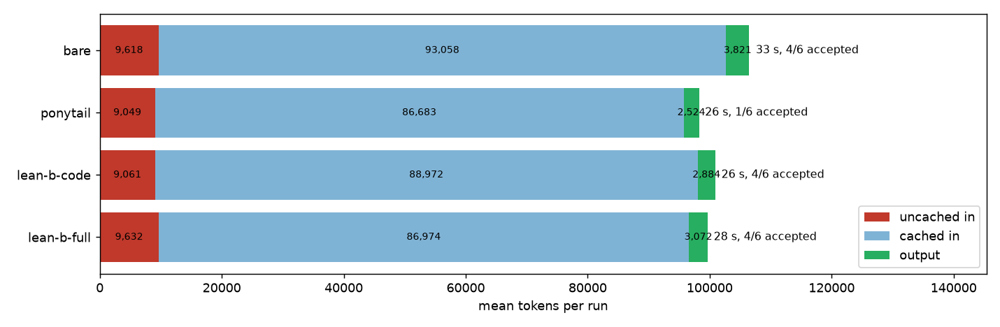

# Lean B benchmark results (#239), 2026-11-20

Small pilot, not the full plan. Claims below stop at what 6 runs per arm can show.

## Setup
- Model `claude-opus-5-5`, reasoning effort low, `claude -p` in a clean profile (no user settings, hooks, MCP, CLAUDE.md). Runner: `lean_b_run.py`.
- Tasks: ladder L1 (interval merge) and L2 (dependency fixture) from flow/, 3 runs each, 6 runs per arm, arm order shuffled per task and run. Raw lines: `runs.jsonl`.
- Arms run: `bare`, `ponytail` (installed plugin 5.3.3, init record shows it loaded), `lean-b-code` (sections 1-3 appended to the system prompt), `lean-b-full` (sections 1-5).
- **Not run:** `caveman` (not installed here, nothing to measure), L3 and L4, Opus at the plan's 3 runs on all four levels. Spend: $3.70 list price for all 24 runs (estimate was about $5, abort limit $10).
- Accepted = the level's own checker passes. The reviewer check for cuts from the never-cut list was **not** done.
- A first pass of 8 runs was discarded: my activation check wrongly voided arms (bug, fixed). The 24-run run crashed once at run 14 without a trace; the 10 missing runs were run afterwards with the same settings.

## Per arm, mean per run, each value against `bare`
Uncached input includes cache writes.

| arm | runs | uncached in | cached in | output | time | accepted |
|---|---|---|---|---|---|---|
| bare | 6 | 9,618 (baseline) | 93,058 (baseline) | 3,821 (baseline) | 33 s (baseline) | 4/6 (baseline) |
| ponytail | 6 | 9,049 (6% less) | 86,683 (7% less) | 2,524 (34% less) | 26 s (22% faster) | 1/6 (75% lower) |
| lean-b-code | 6 | 9,061 (6% less) | 88,972 (4% less) | 2,884 (25% less) | 26 s (20% faster) | 4/6 (baseline) |
| lean-b-full | 6 | 9,632 (0% more) | 86,974 (7% less) | 3,072 (20% less) | 28 s (15% faster) | 4/6 (baseline) |

Cost per accepted task (list price 5 / 6.25 / 0.5 / 25 per Mtok, failed runs counted): bare $0.303, lean-b-code $0.260 (14% less), lean-b-full $0.271 (11% less), ponytail $0.978 (222% more, one acceptance).

## What the numbers support
- Output tokens drop 20 to 34% in every treatment arm, and runs are 15 to 22% faster. Output is a small part of the total, so total tokens move only 0 to 7%.
- Acceptance: lean-b arms equal bare (4/6). Ponytail accepted 1/6; I did not diagnose why per arm (one failing workspace I inspected failed the checker's input-validation test).
- Cost per accepted task is 11 to 14% lower for the lean-b arms, but it rests on 4 accepted runs each and bare itself failed 2 of 6 (L2 is the hard one), so a one-run swing moves it by tens of percent. **This is a lean signal at best, not a confirmed saving; no claim that Lean B beats Ponytail or Caveman.**
- Ponytail's result may reflect the checker rewarding validation that its ladder omits, which is the never-cut question, not a speed one.

## Done-when for #239
- Benchmarked against Ponytail and Caveman: **not met** (Caveman not run, sample small).
- Cost per accepted task reported for each arm run: met for the four arms above.
- Prose levels off for docs, commits, PR bodies: static check only (rule section 4); dynamic check **not run**.
